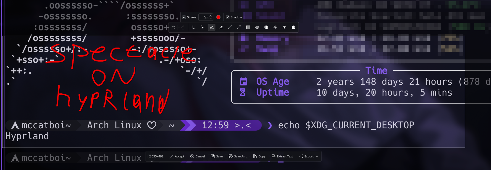

<!--
    SPDX-FileCopyrightText: 2026 hyprtacle contributors

    SPDX-License-Identifier: BSD-3-Clause
-->

# hyprtacle

D-Bus service that speaks the `org.kde.KWin.ScreenShot2` interface on Hyprland.
Allows Spectacle to take screenshots. Workflow is not changed.



## Why

Spectacle captures on Wayland through KWin only: `ScreenShotEffect::isLoaded()`
checks whether `org.kde.KWin.ScreenShot2` is registered on the session bus.
Without it Spectacle falls back to `ImagePlatformNull` and exits silently.

Region selection and annotations are Spectacle's own code (`SelectionEditor`,
`CaptureOverlay.qml`, KQuickImageEditor). Only the capture backend is missing.

## Requirements

| | |
|---|---|
| Hyprland | compositor |
| `grim` | capture, `zwlr_screencopy_manager_v1` |
| `hyprctl` | monitor and window geometry |
| Qt 6.5+, CMake 3.16+, C++20 | build |

Spectacle is optional: any client of the interface works.

## Build

```sh
cmake -B build -G Ninja -DCMAKE_BUILD_TYPE=RelWithDebInfo -DCMAKE_INSTALL_PREFIX=~/.local
cmake --build build
cmake --install build
```

Installed:

```
~/.local/bin/hyprtacled                          daemon
~/.local/bin/hyprtacle-capture                    test client
~/.local/share/dbus-1/services/org.kde.KWin.ScreenShot2.service
~/.local/share/systemd/user/hyprtacled.service
```

With a `/usr` prefix the unit goes to `/usr/lib/systemd/user` — systemd does
not look in `/usr/share/systemd/user`.

Arch: `packaging/aur/PKGBUILD`.

## Start

The daemon has to run **before** the client: Spectacle calls
`isServiceRegistered()`, which does not activate a service.

```sh
systemctl --user enable --now hyprtacled.service
journalctl --user -u hyprtacled.service
```

or from the Hyprland config (Lua, Hyprland 0.56+):

```lua
hl.exec_cmd("pgrep -x hyprtacled >/dev/null 2>&1 || exec $HOME/.local/bin/hyprtacled")
```

Older Hyprland, hyprlang syntax:

```conf
exec-once = pgrep -x hyprtacled >/dev/null 2>&1 || exec hyprtacled
```

The unit looks for the wayland socket in `$XDG_RUNTIME_DIR` when the user
manager has no `WAYLAND_DISPLAY`.

The daemon exits with code 0 if the session is not Hyprland, or if the bus name
is already taken (real KWin).

## Verify

```sh
hyprtacled --check                                 # environment report
hyprtacle-capture screen out.png                 # by monitor name
hyprtacle-capture active out.png                 # focused monitor
hyprtacle-capture window out.png                 # active window
hyprtacle-capture area out.png "10,10 300x200"   # rectangle
spectacle -r                                     # region + annotations
```

## Interface

`org.kde.KWin.ScreenShot2`, object `/org/kde/KWin/ScreenShot2`, `Version` = 2.
The XML is a verbatim copy of KWin's, so the introspection matches.

| Method | Result |
|---|---|
| `CaptureScreen(s, a{sv}, h)` | monitor by output name |
| `CaptureActiveScreen(a{sv}, h)` | focused monitor |
| `CaptureActiveWindow(a{sv}, h)` | rectangle of the active window |
| `CaptureArea(iiuua{sv}, h)` | rectangle in logical coordinates |
| `CaptureInteractive(0, a{sv}, h)` | window under the cursor |
| `CaptureInteractive(1, a{sv}, h)` | monitor under the cursor |
| `CaptureWindow(s, a{sv}, h)` | error: KWin addresses windows by UUID |
| `CaptureWorkspace(a{sv}, h)` | error: added in version 3 |

`CaptureInteractive` is not interactive here: it picks the target under the
cursor instead of showing a picker.

## Protocol

Every method takes a pipe file descriptor and returns `a{sv}`:

```
type    "raw"
format  QImage::Format, 4 (RGB32)
width   uint
height  uint
stride  uint
scale   double, device pixel ratio of the output
screen  string, output name, monitors only
```

Exactly `width * height * 4` bytes follow, tightly packed, in the format above.

The reply goes out first, the pixels go into the pipe afterwards, from a
separate thread (`O_NONBLOCK` + `poll`, 60 s timeout). The client only starts
reading the pipe after it received the reply, and a pipe holds 64 KiB — less
than one screenshot. Writing the data first deadlocks both sides.

`SIGPIPE` is ignored: a client that walks away mid-transfer must not take the
service down.

grim is asked for PPM. The stream is decoded to a QImage right away, so the
client always gets 32 bit pixels.

## Layout

```
src/ScreenshotService.{h,cpp}   D-Bus interface, delayed replies
src/CaptureJob.{h,cpp}          grim invocation, metadata, reply
src/PipeWriter.{h,cpp}          asynchronous pipe writer
src/HyprlandInfo.{h,cpp}        hyprctl queries, JSON parsing
tools/hyprtacle-capture.cpp     D-Bus client, same protocol as Spectacle
data/org.kde.KWin.ScreenShot2.xml
```

## Tests

```sh
ctest --test-dir build
```

Requires a running Hyprland session.

## Limits

- The cursor is not in the picture: grim cannot capture it.
- Windows of the calling process are not hidden. KWin hides them, this does not.
- "Active window" is the screen region the window occupies, not the window
  contents. Decorations and shadow are part of that region.
- Fractional scale: the logical size of a capture can differ from the screen
  size by a fraction of a pixel, as in KWin.
- Rotated monitors are untested.
- No video recording. It is a different interface (`zkde_screencast`).

## Security

The service answers any local process on the session bus, and does not
implement KWin's `X-KDE-DBUS-Restricted-Interfaces` check. Anything that can
run `grim` can already take the same picture.

## License

BSD-3-Clause, except `data/org.kde.KWin.ScreenShot2.xml`, which is copied
verbatim from KWin (`src/plugins/screenshot/org.kde.KWin.ScreenShot2.xml`,
© 2021 Vlad Zahorodnii) and distributed here under LGPL-3.0-only — one of the
three licenses upstream offers. Full texts in `LICENSES/`.
